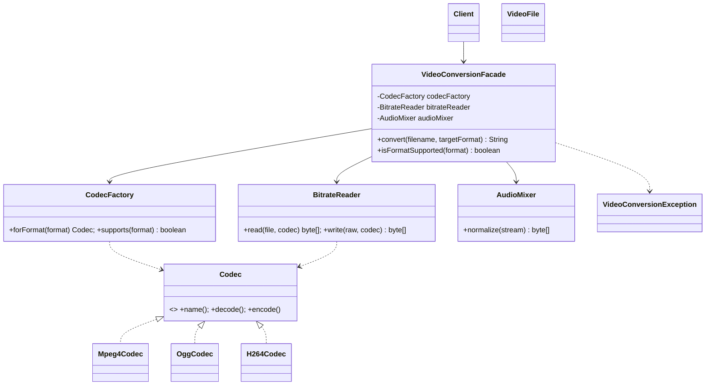

# Assignment #4 — Facade Pattern
**Course:** ShP-2216 Software Design Patterns | **Topic:** Option A — Video Conversion Facade

## 1. Introduction
Converting a video file requires several collaborating classes: `CodecFactory` (chooses a codec for a format), `BitrateReader` (reads the stream and writes the encoded result) and `AudioMixer` (normalizes the audio). A client that had to call them directly would need to know the correct order, how codecs are created and how failures from each class look. The **Facade pattern** is applied: `VideoConversionFacade.convert(filename, format)` gives the client one simple method and hides the whole workflow.

## 2. UML class diagram

Subsystem classes have no reference to the facade.

## 3. Clean Code
**1. Meaningful names.** The API reads like a sentence.
```java
String result = converter.convert("holiday.mp4", "ogg");
```
**2. Single Responsibility.** The facade only coordinates; encoding lives in codecs.
```java
byte[] raw = bitrateReader.read(source, sourceCodec);
byte[] encoded = bitrateReader.write(raw, targetCodec);
byte[] result = audioMixer.normalize(encoded);
```
**3. No leaking of subsystem details.** Public methods use only `String`/`boolean`; `Codec`, `VideoFile` and `IllegalArgumentException` never appear in the facade's signatures.
- Before: `new BitrateReader().read(new VideoFile(...), new CodecFactory().forFormat("mkv"))`
- After: `converter.convert("clip.mkv", "ogg")`

**4. Proper error handling.** Low-level `IllegalArgumentException` is translated into one domain exception.
```java
} catch (IllegalArgumentException e) {
    throw new VideoConversionException("Cannot convert '" + filename + "' to '" + targetFormat + "'", e);
}
```
**5. Small, focused classes + dependency injection.** Each subsystem class has one job; the facade accepts its collaborators via a constructor, so they can be replaced in tests.
```java
public VideoConversionFacade(CodecFactory f, BitrateReader r, AudioMixer m) { ... }
```
**6. Open/closed (bonus).** A new format = one new `Codec` class + one line in `CodecFactory`; the facade does not change.

## 4. Conclusion
The facade hides codec selection, the order of read → encode → audio normalization and subsystem exceptions. It does **not** lock the subsystem: advanced clients can still use `CodecFactory`, `BitrateReader` and `AudioMixer` directly (demo part 3 in `Main`). This is the defining property of the Facade pattern.

## 5. GitHub repository
<insert your link here>
